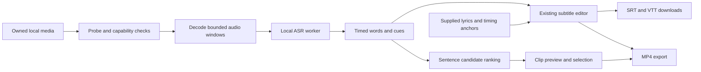

# CaptionX generation tools: competitor research and AENural feasibility

Research date: **9 October 2026**. Project: `D:\Work\Tools\online-tools-platform`.

**Recommendation:** build one small, local speech-to-subtitles engine first, exposed through Podcast to Captions and one canonical Subtitle Generator. Reuse AENural's editor and converters. Add video rendering, assisted lyric timing, and clip suggestions in subsequent, separately verified batches. Nine competitor URLs do not justify nine independent engines.

This was research only. No product source, tests, dependency manifests, registry, recovery audit, or configuration were changed. No commit, push, deployment, purchase, signup, or private endpoint inspection occurred. No paid inference API was integrated or called directly; CaptionX's internal providers were not inspected. Research scripts and owned fixtures live under `artifacts/captionx-research-fixtures/`.

## 1. Evidence and limitations

Evidence labels used throughout:

| Label | Meaning |
|---|---|
| H | Hands-on interaction through the supported Chrome browser controls |
| P | Individual public page or public HTML form inspected; does not prove processing works |
| D | Publisher documentation or an explicit website claim |
| I | Engineering inference or recommendation, not a measured result |
| U | UNVERIFIED functionality |

All **nine individual URLs** were opened using public web access. Each returned HTTP 200 in a separate read-only public form inventory. Live Chrome additionally inspected Clips, Studio, Podcast to Captions, Lyrics to Captions, and Free Subtitle Generator. **Only Studio and Lyrics to Captions processed uploaded media successfully in this run.** Clips received control interactions only. Podcast received inspection only. The Free Subtitle Generator file-chooser attempt failed at the automation layer before a verified upload.

Browser automation then lost its request-policy connection. One normal supported availability check also failed; reconnection attempts stopped. Consequently AI Subtitle Generator, YouTube Subtitle Generator, Lyric Video Maker, and Suno Lyrics Captions were inspected individually through public pages/forms, without processing tests. Seven tools lack verified end-to-end processing; Studio's MP4 export also remains unverified. This is an environment limitation, **not evidence those tools are broken**.

Chrome already had a signed-in CaptionX session. No credentials were read or entered, and the account identity is deliberately omitted. Successful generation in this session does not prove anonymous access, remaining quota, or a particular subscription entitlement. No limit or payment gate was bypassed.

### Owned test media and downloaded evidence

The test is original English narration synthesized locally with an installed Windows voice. It contains a boat/checklist story and ends with the word “lighthouse”; no customer material, music, or copied competitor sample was uploaded.

| Artifact | Verified facts |
|---|---|
| `captionx-research-fixtures/original-speech.wav` | Mono PCM16, 22,050 Hz, 27.694875 seconds, 1,221,390 bytes; uploaded to Studio and Lyrics to Captions |
| `captionx-research-fixtures/original-speech.mp3` | Same owned speech, 444,290 bytes; prepared for Podcast testing but **not uploaded** before browser access failed |
| `captionx-research-fixtures/CaptionX_original-speech.srt` | Actual Studio browser download, 911 bytes, 15 parseable cues |
| `captionx-research-fixtures/original-speech.srt` | Actual Lyrics browser download, 911 bytes, 15 parseable cues |
| `captionx-research-fixtures/original-speech.vtt` | Actual Lyrics browser download, 883 bytes, valid WEBVTT header and 15 parseable cues |
| `captionx-research-fixtures/download-verification.json` | Saved sizes, cue counts and SHA-256 hashes for all three downloaded files |
| `captionx-research-fixtures/public-controls.json` | Sanitized per-page file types and select options; no scripts, account data, or competitor styling copied |

The three downloads were read from the browser's actual Downloads directory, copied into the evidence folder, and parsed with AENural's existing parsers. All include the final word. First cue begins at 0.160 seconds and last cue ends at 26.900 seconds, within the recording. The narration was recognizable throughout on inspection; no formal human word-boundary annotation, WER benchmark, singing test, or multilingual test was performed. Single-word cues such as “lake” are a real readability weakness in this sample.

No new CaptionX MP4 was found among actual downloads after export was initiated. Playback, audio preservation, watermark appearance, and render completion are **U**, not successful tests. Screenshots were not retained before browser access failed; the evidence consists of observed UI states and saved subtitle files.

## 2. What actually exists in AENural

Inspected `AGENTS.md`, `package.json`, `src/`, `tests/`, `src/lib/tools.ts`, `src/lib/discovery.ts`, `src/app/sitemap.ts`, metadata helpers, completed conversion implementations, `artifacts/aenural-recovery-audit.md`, and `references/AENural-design-reference.html`.

| Existing area | Current state and reuse |
|---|---|
| Brand and flagship | AENural is the brand. `/source-window` presents AENural Source Window as the After Effects flagship. Keep generation tools subordinate to that product identity. |
| Six editing tools | SRT Timing Adjuster, SRT Merger, SRT Splitter, Subtitle Editor, Subtitle Sync Fixer, Subtitle Overlap Fixer. Implemented; the audit still records historical release-acceptance gaps. |
| Ten format converters | SRT→VTT, VTT→SRT, SRT→ASS, SRT→TXT, SRT→JSON, VTT→TXT, SRT→MP4, SBV→SRT, SRT→SBV, ASS/SSA→SRT. Preserve these. |
| Registry/discovery | 16 released local tools, one Subtitle Tools category, two groups: Timing & Editing and Format Conversion. Registry feeds discovery and sitemap. No Caption Generation group or released generation tool exists. |
| Existing editor | SRT/VTT parsing, editable text/times, validation, history/dirty-state handling and downloads. Reuse its document model and established interactions; a generation result adapter should not replace the editor. |
| Media foundation | Next 16.3.8, React 19.2.8, TypeScript, fflate, Mediabunny **1.61.3**. No installed ASR, embedding, alignment or local language-model runtime. |
| Existing SRT→MP4 | Canvas text → WebCodecs H.264 → Mediabunny MP4. Silent solid-background video, 480p/720p, maximum 120 seconds and 500 cues. It does **not** burn captions into uploaded video, mux a song, transcribe, or find clips. |
| Prior verification | Recovery audit records 513 tests/56 suites, including 149 converter-related tests, and previous downloaded-MP4 playback. These are historical project evidence, not tests rerun during this research. |
| Release infrastructure | Sitemap requires a valid SITE_URL; the audit records it missing. `next.config.ts` does not establish cross-origin isolation. Hostinger plan, production headers and bandwidth allowance were not inspected. |

Relevant reuse points: `src/lib/srt.ts`, `src/lib/subtitle-editor.ts`, `src/lib/subtitle-conversion.ts`, `src/lib/subtitle-video.ts`, `src/features/srt-to-mp4/render-mp4.ts`, and existing feature/session components. Existing source and tests already had uncommitted work at the start; it was preserved. Current installed Next guidance must be read before any later implementation, as AGENTS.md requires.

## 3. Nine-page feature comparison

File-picker accept attributes are browser hints, **not proof every advertised codec succeeds**. Limits below are visible page limits unless explicitly described as enforced tests.

| Tool / individual page | Actual entry controls and limits (H/P) | Workflow, output and gates | Evidence / AENural gap |
|---|---|---|---|
| [AI Clip Generator](https://caption-x.com/clips) | File picker for MP4/MOV/M4A; HTML also allows M4V. Three length presets: 15–30, 15–60, 45–90 seconds. Auto language plus 13 named languages. Page advertises sources up to 3 hours; no visible byte limit found. | Choose file → range/language → generate → ranked playable candidates → keep/export. Free previews and paid keeping/downloading are described (D); final gate mechanics U. No YouTube URL field at entry. | H controls/P/D; no media processing. AENural has neither ranking nor media cutting. |
| [Auto Caption Generator / Studio](https://caption-x.com/studio) | MP4/MOV/WebM video or MP3/WAV audio; picker also has broad video MIME hint. Visible maximum 10 minutes and under 2 GB. Attached WAV was identified as a song of about 28 seconds. | Choose → generate → timed editable transcript/preview → scene/template/style → SRT or captioned MP4. Free MP4 watermark and Pro translation/removal controls visible (H); exact anonymous gates U. | H generation and actual SRT; MP4 initiated but completion/playback U. AENural needs ASR, source-video compositing and audio handling. |
| [Podcast to Captions](https://caption-x.com/podcast-to-captions) | MP3-only picker, 10 MB. No tool-level language or segmentation setting found. Generate/re-download initially disabled. | Attach MP3 → generate → automatic SRT download → re-download. A short-sample workflow, not a full podcast editor (P/D). No visible integrated result editor at entry. Processing/gates U. | H initial UI/P/D; no upload. AENural can use the same short-speech ASR engine as general subtitles. |
| [Lyrics to Captions](https://caption-x.com/lyrics-to-captions) | MP3/WAV, 100 MB; auto or 98 named language options; phrase or word segmentation; optional multiline supplied lyrics. | Attach → settings/optional lyrics → generate/cancel/progress → synchronized caption preview → SRT/VTT or Studio handoff. Regeneration available. | H speech processing and two real exports. Singing, supplied-lyrics alignment and word mode U. No inline cue editor was exposed in the inspected result; correction is directed toward regeneration/Studio. |
| [Lyric Video Maker](https://caption-x.com/lyric-video-maker) | Same MP3/WAV, 100 MB, language, phrase/word and optional-lyrics form independently confirmed in public HTML. | Generate lyric timing → Studio background/style/aspect ratio → browser MP4 (D). Entry itself still offers subtitle downloads; finished-video stage lives in Studio. | P/D only, all processing U. Shares music entry workflow; video rendering is a meaningful added stage. |
| [Suno Lyrics Captions](https://caption-x.com/suno-lyrics-captions) | Same MP3/WAV, 100 MB, language, segmentation and optional lyrics form independently confirmed. No Suno URL, account integration or project importer found. | Download one's own track from Suno → local file upload → timing preview → SRT/VTT; optional lyric-video handoff (P/D). Gates U; page claims no signup. | P/D only. Appears to specialize the general music workflow by audience, not require a Suno-specific model. |
| [Free Subtitle Generator](https://caption-x.com/free-subtitle-generator) | MP3/MP4/WAV/M4A/FLAC/OGG/WebM, 25 MB. HTML additionally admits MOV and broad audio MIME. Output-language selector has **57** options, English default. | File + output language → generation → automatic SRT → re-download. Page describes five free SRT files with a free account, then subscription (D). Translation via output-language choice is claimed, U. | H initial UI/P/D; chooser failed before verified upload. No result editor exposed at entry. |
| [AI Subtitle Generator](https://caption-x.com/ai-subtitle-generator) | Same accept list, 25 MB and 57-option output-language selector independently confirmed. | Same file→language→SRT/re-download flow; five-free-account allowance documented. No distinct AI settings found. | P/D only. Shared public controls strongly suggest the same product capability as Free Subtitle Generator; private implementation is unknown. |
| [YouTube Subtitle Generator](https://caption-x.com/youtube-subtitle-generator) | Same local-file picker, 25 MB and 57-option selector independently confirmed. **No URL input**. | Local original/downloaded own media → SRT → manual upload in YouTube Studio. Five-free allowance documented. Direct publishing not exposed. | P/D only. An SRT-generation use case, not arbitrary YouTube downloading/transcription. AENural's existing SBV/SRT tools already cover adjacent file conversion. |

The generic subtitle pages advertise wider language coverage than the inspected 57-option form. This is a discoverability mismatch, not a measured failure of languages absent from the selector. The music forms expose 98 named languages plus automatic detection; recognition quality across them remains U. No duration-limit enforcement, oversized-file rejection, corrupt-media handling, rate-limit behavior, or mobile processing was tested on CaptionX.

### Hands-on flow details

**Studio (H):** selected the owned WAV, saw filename/duration and a remove action, then initiated generation. Processing showed a progress bar, elapsed time, cancel action and stages for extraction, transcription and cue creation; audio followed a vocal-processing path. It completed to 15 editable text fields with cue-time buttons, line playback/deletion and a main preview. Scene controls included three aspect ratios, solid/gradient or image background, speed and optional visual effects. Template/style tabs and vertical position were present; exhaustive option testing was not performed. A tutorial followed by a timeline announcement interrupted actions until dismissed. The SRT saved successfully. MP4 export disabled scene controls, but no completed file or playback was verified before automation became unavailable. Generation completed between inspections; timings were not instrumented and should not be advertised as a speed benchmark.

**Lyrics to Captions (H):** selected English and phrase mode, attached WAV without supplied lyrics, saw filename/size/replace guidance, then generated. Initial progress showed preparation at 3% with cancellation. Result exposed language, caption preview, review warning, regeneration and a Studio handoff. SRT/VTT both saved and parsed. This was a **speech smoke test** of a music tool. It does not establish vocal separation quality, singing alignment, karaoke precision or correction behavior when supplied lyrics disagree with audio.

**Clips (H):** inspected all three range buttons and language choices, selected the shortest range and pressed generation without a file. No new error/result appeared in the immediate snapshot. This is weak validation feedback at that observed moment, not a proven processing bug. No clip suggestions, quality scores, preview or export were produced or tested.

**Other pages:** public page/forms and documented steps only. Podcast's lack of language controls and the simple generic subtitle forms were visible. Browser failure prevented owned MP3 submission. There was no legitimate reason to claim these processing paths successful by analogy with Studio.

## 4. CaptionX strengths, weaknesses and useful AENural improvements

**Observed strengths:** low initial input burden; dedicated audio-only route; filenames/replace guidance on lyric upload; useful lyric result instead of a separate redundant preview; real standard subtitle downloads; Studio's editable transcript and direct per-line playback; clear destination handoffs between subtitles and rendered media.

**Documented strengths requiring further verification:** clip discovery using the whole transcript, sentence-bounded candidates, ranking for standalone value, full preview before purchasing, broad transcription languages and browser rendering. The published two-hour clip-processing speed is not measured here. Treat ratings, accuracy and marketing performance statements as claims, not independent evidence.

**Observed or documented friction:** overlapping generator pages obscure product distinctions; byte limits differ substantially by route; advertised language breadth exceeds the generic selector; Studio's audio assumption routes speech through a song workflow; two onboarding interruptions obstruct immediate export; phrase grouping created several very short cues on clear narration. Studio is considerably busier after generation than the minimal upload screen. Account/allowance terms are clearer lower on some pages than near the first action. Actual gate enforcement is U.

**AENural improvements (I):**

- State the concrete output near upload: editable SRT/VTT, captioned source video, or song plus lyrics. Preserve the Sora/Inter, orange/teal, surfaces, header/footer and breadcrumb system.
- Use duration **and** size limits. Show compatibility and model download before lengthy work; do not imply every device can handle the same workload.
- Show one status area with real stages: checking file, downloading model bytes, loading model, transcribing elapsed media, preparing result. Avoid invented percentages or instant-processing promises.
- Make review, an explicit download, replace and reset obvious. Avoid auto-download as the only success indication. Keep a repeated download available.
- Add a direct handoff into the existing Subtitle Editor and existing converters without retranscribing. Preserve the user's edits and source ownership.
- Keep speech language distinct from translation. First release should transcribe the supported language, not suggest arbitrary target-language translation is included.
- Offer optional styling only when the requested output is video; keep raw subtitle generation compact. Do not reproduce CaptionX's wording, visual templates, effects or onboarding.

## 5. Shared capability architecture

This grouping is an inference from public workflows and controls, **not an assertion about CaptionX's private code**:

| Engine / layer | Pages it serves | AENural approach |
|---|---|---|
| Media intake and decoding | All nine | Shared file validation, metadata probe, local audio extraction, bounded PCM decoding/resampling, cancellation and capability checks. |
| Speech transcription and cue creation | Podcast, Free, AI, YouTube; Studio; Clips upstream | One worker-based ASR adapter and one cue builder. Thin purpose-specific entry points only when they improve workflow. |
| Music text/timing | Lyrics, Suno, Lyric Video; Studio audio mode | Separate alignment policy, supplied-text preservation and manual timing. Reuse cue model/export; do not treat singing as ordinary speech accuracy. |
| Review and subtitle output | Every transcription route | Reuse existing AENural editor/parsers/exporters through an adapter; no duplicate editing application. |
| Media composition/export | Studio, Lyric Video, Clips | Extend media capabilities in isolated modules; reuse Mediabunny. Existing silent SRT→MP4 remains protected and accurately scoped. |
| Highlight analysis | Clips only | Sentence/word transcript indexing, candidate generation, transparent local ranking, diversity and preview, then exact cutting/export. |

Suggested data flow:

Use seconds or integer milliseconds consistently at module boundaries, stable cue IDs, original media offsets, language and model-revision metadata, and separate word timing from displayed cue grouping. Keep transcription state in a dedicated session controller; late worker messages from replaced files must not overwrite current work. Worker termination is a real cancellation fallback. Heavy model/media code loads only after a user starts the relevant action; unrelated converters should not receive AI bundles.

## 6. Technical options without paid inference APIs

### Local speech recognition

**Preferred candidate: Transformers.js + ONNX Whisper in a dedicated worker.** It provides browser ASR with WASM CPU execution and optional WebGPU. The ASR interface documents chunking and word timestamps. These features establish an available implementation path, not proven accuracy or speed in AENural. Pin a tested runtime, ONNX Runtime build, model revision and precision combination rather than importing floating latest assets. The documentation's main branch and stable-version examples differ; compatibility must be checked at implementation time. [Transformers.js](https://huggingface.co/docs/transformers.js/index), [ASR interface](https://huggingface.co/docs/transformers.js/v3.8.1/api/pipelines), [WebGPU guide](https://huggingface.co/docs/transformers.js/v3.8.1/guides/webgpu).

Start with English tiny for small jobs and benchmark multilingual base as an opt-in later. Do not expose 100 language choices merely because a model lists many languages. Test each advertised language, particularly Urdu/Arabic text direction, numerals and code switching. Whisper's own model card documents uneven language performance, repetition and invented text; silence/music require explicit tests and no-speech behavior. [Whisper model card](https://github.com/openai/whisper/blob/main/model-card.md).

Probe WebGPU, then perform an actual model smoke run; API presence alone is insufficient. Handle GPU loss, unavailable precision, unsupported operators and memory errors. Offer an explicit smaller CPU mode with shorter limits. WASM multithreading requires browser support plus cross-origin isolation; single-thread CPU is the conservative fallback. Adding COOP/COEP needs deployment/header and third-party-resource testing, not just a Next configuration edit. [ONNX Runtime environment flags](https://onnxruntime.ai/docs/tutorials/web/env-flags-and-session-options.html), [isolation guide](https://web.dev/articles/cross-origin-isolation-guide).

**Alternative: whisper.cpp/WASM.** Its official browser example and SIMD requirement make CPU browser ASR credible. It introduces a compiled WASM/build lifecycle and model format separate from Transformers.js. Native Metal/CUDA support does not imply equivalent browser acceleration. The inspected repository did not establish a production browser WebGPU path; treat that combination as U rather than a drop-in replacement. Benchmark it only if the preferred stack fails the selected CPU/device acceptance gates. Do not ship both engines initially. [whisper.cpp](https://github.com/ggml-org/whisper.cpp), [browser example](https://github.com/ggml-org/whisper.cpp/blob/master/examples/whisper.wasm/README.md), [SIMD requirement](https://github.com/ggml-org/whisper.cpp/blob/master/examples/whisper.wasm/index-tmpl.html).

Do not substitute ordinary browser SpeechRecognition for a guaranteed private offline uploaded-file engine. Some implementations use a remote recognition service; newer local features still require capability and language checks. [MDN SpeechRecognition](https://developer.mozilla.org/en-US/docs/Web/API/SpeechRecognition).

### Decoding and long media

For short audio, Web Audio decoding is straightforward but operates on a complete file and yields a resampled AudioBuffer. For longer video/audio, prefer demuxing plus bounded WebCodecs audio decoding through the existing Mediabunny foundation, then deterministic mono conversion and 16 kHz resampling. Container acceptance is separate from audio-codec decode support. Reject unsupported tracks before model download where possible; provide a clear request for a supported local audio file. [decodeAudioData](https://developer.mozilla.org/en-US/docs/Web/API/BaseAudioContext/decodeAudioData), [Mediabunny reading](https://mediabunny.dev/guide/reading-media-files).

Do not decode an entire three-hour source into stereo Float32 memory: 48,000 × 2 × 4 × 10,800 = **4.147 GB decimal** for PCM alone. Even mono 16 kHz Float32 is 691.2 MB. A five-minute source at stereo 48 kHz is 115.2 MB before resampling, model tensors, file buffers or preview frames. These are calculated allocations, not observed browser memory use. Process overlapping windows, release samples promptly, reconcile repeated boundary words and retain original timeline offsets.

### Lyrics and alignment

Supplied lyrics and audio transcription solve different problems. A text prompt or edit-distance match can correct words but cannot establish when missing/repeated sung words occurred. A proper forced aligner uses acoustic emissions and a constrained alignment path; speech-trained CTC models may still fail on sustained singing, backing vocals, repeated choruses and instrumental sections. WhisperX demonstrates a separate language-specific alignment stage, but is a Python/native workflow, not a browser dependency. [Forced alignment principles](https://docs.pytorch.org/audio/stable/tutorials/forced_alignment_tutorial.html), [WhisperX](https://github.com/m-bain/whisperX).

Practical V1: supplied lyrics or imported SRT/LRC, local playback, manual line start/end anchors and optional low-confidence draft suggestions. Preserve repeated lines, Unicode and section labels intentionally. Clearly identify untimed lines. Never distribute lyrics evenly across a song and call them synchronized. Automatic lyric extraction/alignment remains experimental until real singing fixtures pass. Vocal separation can help but introduces another model/runtime and substantial processing; Demucs is an example of source separation, not a verified browser solution, and its original repository is archived. [Demucs](https://github.com/facebookresearch/demucs).

### Browser MP4 rendering

Retain Mediabunny and WebCodecs as the first architecture to investigate. Decode frames → composite readable captions on Canvas/OffscreenCanvas → encode H.264 → mux video with copied compatible audio or newly encoded AAC. Reuse the song's full duration, including instrumental gaps; existing silent-caption export duration is insufficient for this use case. Probe actual codec/configuration support, bound queues, close VideoFrame/AudioData objects and keep timestamps synchronized. [WebCodecs guide](https://developer.mozilla.org/en-US/docs/Web/API/WebCodecs_API/Using_the_WebCodecs_API), [codec checks](https://mediabunny.dev/guide/supported-formats-and-codecs).

AAC encoding is a separate compatibility risk from H.264. Mediabunny documents an optional WASM AAC extension; consider it only after checking its version compatibility with installed 1.61.3, compressed size, license and playback. No new encoder was installed or tested here. Prefer source AAC packet reuse when valid. Never label WebM as MP4. A supported WebM alternative can be offered by its real name. [AAC extension](https://mediabunny.dev/guide/extensions/aac-encoder).

Keep output small initially. Mediabunny documents memory targets and streaming alternatives; using an in-memory result for arbitrarily long videos can exhaust memory. For larger exports, use a supported local file stream or OPFS staging with quota checks, then validate final media. Interleave audio and video production. Current documentation may describe APIs newer than the pinned package, so check installed types before implementation. [Writing media](https://mediabunny.dev/guide/writing-media-files).

**ffmpeg.wasm is an optional fallback investigation, not the default.** Its example core is approximately 31 MB; the project documents slower operation than native, higher resource use for multithreading and an input-size constraint. That does not make huge inputs safe below the stated limit. Its core and codecs have licenses distinct from the MIT wrapper. Avoid loading an entire FFmpeg stack alongside ASR without a measured need. [Usage](https://ffmpegwasm.netlify.app/docs/getting-started/usage/), [FAQ](https://ffmpegwasm.netlify.app/docs/faq/), [performance](https://ffmpegwasm.netlify.app/docs/performance/).

## 7. AI Clip Generator: discovery, ranking and honest limits

CaptionX exposes **ranges**, not one fixed duration. Its public explanation says transcript sentences are selected, then mapped to timing; overlapping analysis windows feed ranking by standalone appeal and narrative quality. The page describes server-side analysis and uploading extracted audio, with source upload in some cases. Free preview is not a demonstrated free-export promise. None of the ranking, sentence guarantees, length enforcement, long-source speed or export behavior was hands-on verified here. [CaptionX Clips](https://caption-x.com/clips).

### Proposed local discovery pipeline (I)

1. Transcribe or accept a user-provided timed transcript; retain word offsets and source reference.
2. Create sentence units using punctuation plus silence cues. ASR punctuation is fallible; flag uncertain boundaries. A complete grammatical sentence can still depend on earlier context.
3. Enumerate contiguous sentence spans inside the requested range. Search across overlapping transcript windows. If no whole-sentence span fits, return fewer/zero candidates; never silently cut a word to hit a quota.
4. Rank deterministic features: a clear question or surprising statement near the start; concrete advice/story resolution near the end; reasonable speech density; limited silence; penalties for unresolved pronouns, conjunction openers, unfinished setup, boilerplate and repetition. Normalize these into **relative suggestion scores**, not predicted views or objective quality.
5. Optionally add local sentence embeddings for topic coherence, novelty, query relevance and diversity. Embeddings measure similarity; they do not understand hook/payoff quality sufficiently by themselves. A validated human-labeled ranker could later combine features. A local small LLM is a separate, heavier research option, not necessary for V1 and not proven here.
6. Deduplicate high-overlap candidates and surface at most five suggestions with a short explanation and transcript. Let the user inspect boundaries and keep/reject them.
7. Preview only the selected interval against the local source. Export one clip at a time with exact offsets, audio sync and honest codec restrictions.

**First release limits proposed, not benchmarked:** desktop-first, English, up to 10 minutes/250 MB of compatible MP4 with readable audio; 15–30 or 30–60-second ranges; no automatic reframing, speaker tracking, diarization, captions styling or “virality” promises. Permit supplied SRT as a way to avoid ASR cost, with validation against duration; disclose that cue-level timings provide less precise sentence boundaries. Do not claim a supplied-transcript-only release equals automatic content analysis from audio.

Exact cuts require more than remuxing at the nearest keyframe. Decode from an earlier keyframe and encode the intended output interval, rebase timestamps, handle audio packet boundaries and verify the first/last spoken words. Fast copy can be offered only with explicitly approximate boundaries. Semantic selection without correct playable cutting is incomplete; cutting at fixed intervals without semantic selection is not an AI clip generator.

A two-hour source would require 120 minutes if local real-time factor is 1, or 360 minutes at factor 3, excluding download/render. These are arithmetic examples, not measured model speeds. ASR, not embedding lookup, is likely the dominant cost. Hold only bounded audio/frame windows; defer long recordings until memory, recovery and performance are proven. Mobile three-hour processing is **LOW feasibility for a reliable first release**.

Local heuristics and embeddings can deliver useful suggestions without paid APIs. Matching a stronger server language model's contextual hook/payoff judgment is **not established**. Evaluate human preference against random and fixed-interval baselines before using quality claims.

## 8. Model downloads, caching and licenses

Sizes below are rounded publisher file-list values inspected on the research date. **They are selected weight files, not full application downloads or peak memory.** Runtime WASM, tokenizer/configuration files and caches add overhead. Actual requested graphs depend on the pinned adapter and timestamp mode; verify the network manifest before publishing download estimates. Do not download every precision variant in a repository.

| Candidate | Verified files / approximate selected total | Use / caveat |
|---|---|---|
| ONNX Whisper tiny.en q8 | Encoder quantized 10.1 MB + merged decoder quantized 30.7 MB = **40.8 MB** | English short-speech candidate. Check whether the chosen runtime loads this merged graph or separate decoder graphs. |
| tiny.en fp16 | 16.5 MB encoder + 59.6 MB merged decoder = **76.1 MB** | GPU candidate only after precision/operator checks. |
| tiny.en mixed precision | fp32 encoder 32.9 MB + q8 merged decoder 30.7 MB = **63.6 MB** | Candidate when encoder quantization hurts quality; test backend support. |
| ONNX Whisper base multilingual q8 | 23.2 MB encoder + 53.7 MB merged decoder = **76.9 MB** | Optional broader-language experiment, not automatic mobile default. |
| MiniLM-L6-v2 ONNX embedding | `model_quantized.onnx` **23 MB** | Optional English semantic ranking/coherence. Tokenizer/runtime extra. |
| whisper.cpp standard models | tiny **75 MiB**, base **142 MiB** disk; documented native memory approximately 273/388 MB | Different format/runtime. Native memory figures are not browser measurements. Quantized models can reduce size, but a selected build was not measured here. |

Sources: [tiny.en file list](https://huggingface.co/onnx-community/whisper-tiny.en/tree/main/onnx), [base file list](https://huggingface.co/onnx-community/whisper-base/tree/main/onnx), [MiniLM files](https://huggingface.co/Xenova/all-MiniLM-L6-v2/tree/main/onnx), [whisper.cpp memory table](https://github.com/ggml-org/whisper.cpp#memory-usage). Quantization should be evaluated per model component; smaller bit labels do not guarantee smaller files or equal accuracy. [Quantization guidance](https://huggingface.co/docs/transformers.js/guides/dtypes).

Transformers.js supports browser model caching. Plan explicit initial download consent, byte progress, model/revision visibility, retry, cache inspection/removal and offline reuse. Cache API storage is not permanent: private mode, quota pressure or browser eviction can remove it. “Offline” means after the application and required assets are available locally; caching weights alone does not make an uncached Next route load offline. Do not silently persist user media/transcripts alongside the model. [Cache setting](https://huggingface.co/docs/transformers.js/v3.8.1/api/env), [storage quotas and eviction](https://developer.mozilla.org/en-US/docs/Web/API/Storage_API/Storage_quotas_and_eviction_criteria).

| Component | License evidence / distribution action |
|---|---|
| Whisper upstream code and weights | MIT according to [upstream](https://github.com/openai/whisper#license). Retain license/copyright, pin the exact converted weights and record provenance. The inspected ONNX tiny card links upstream but does not itself display an explicit license field; resolve its packaged notices before distribution. |
| Transformers.js | [Apache-2.0](https://github.com/huggingface/transformers.js/blob/main/LICENSE); include required license/notices for the shipped version. |
| ONNX Runtime | [MIT](https://github.com/microsoft/onnxruntime/blob/main/LICENSE); include notices for runtime and bundled third-party components. |
| whisper.cpp | [MIT](https://github.com/ggml-org/whisper.cpp/blob/master/LICENSE); native/backend portability does not license unrelated checkpoints. |
| MiniLM candidate | [Model card](https://huggingface.co/sentence-transformers/all-MiniLM-L6-v2) and ONNX repository identify Apache-2.0. Preserve upstream and conversion provenance. |
| Mediabunny | Installed 1.61.3 identifies MPL-2.0; [license](https://github.com/Vanilagy/mediabunny/blob/main/LICENSE). Keep notices and source availability obligations for covered files; review any codec extension independently. |
| Alignment/separation models | Check **weights separately from code**, language checkpoints, training restrictions and redistribution rights. For example [MMS-1b-all](https://huggingface.co/facebook/mms-1b-all) is CC-BY-NC-4.0; it is not a default commercial AENural recommendation simply because it is downloadable. |
| Media codec fallback | FFmpeg builds and external codecs have their own LGPL/GPL and possible patent considerations. Open-source code licensing alone does not settle every distribution obligation. Assess the actual chosen build before shipping. |

No license acceptance, model download, model execution, browser ASR benchmark or distribution approval was performed in this research. Legal notices and exact asset provenance are implementation release gates, not a reason to introduce paid inference.

## 9. Browser-only feasibility by tool

Ratings are engineering judgments for the explicitly bounded version, not completion claims or verified device support.

| Tool | Browser-only feasibility | Useful no-paid-API version | Limits / equivalence gap |
|---|---|---|---|
| AI Clip Generator | **MEDIUM** | Local ASR or supplied timed transcript → sentence candidates → heuristic/embedding suggestions → local preview/export | Three-hour sources, strong contextual ranking and all-device performance **LOW**. No proven server-model parity. |
| Auto Caption Generator | **MEDIUM** | Short speech video → ASR → existing cue review → simple burned-in captions and real MP4 | Need audio-preserving decode/composite/encode proof. Animated templates/editor breadth postponed. |
| Podcast to Captions | **HIGH** | Short MP3/WAV speech → local English ASR → review → SRT/VTT | Whole episodes, speaker diarization and uniform multilingual accuracy deferred. |
| Lyrics to Captions | **MEDIUM assisted; LOW fully automatic** | Supplied lyrics + playback/manual anchors or imported timings → SRT/VTT | Mixed-song lyric recovery and precise automatic karaoke alignment unproven. |
| Lyric Video Maker | **HIGH with supplied timings; MEDIUM combined workflow** | Audio + reviewed timed lyrics → plain background or owned image → MP4 with audio | Rendering is tractable; reliable auto song alignment remains LOW. AAC/device support must pass. |
| Suno Lyrics Captions | **MEDIUM assisted; LOW fully automatic** | Same lyric engine with guidance for user-owned local exports and pasted lyrics | No special Suno model/integration needed. No harvesting Suno URLs or lyrics. |
| Free Subtitle Generator | **HIGH bounded** | Canonical short-speech generation and editor/export | Limit duration, codecs and initially validated languages; never promise every device. |
| AI Subtitle Generator | **HIGH bounded** | Same canonical speech engine | No independent implementation needed. Prefer clear canonical product naming over duplicate listing count. |
| YouTube Subtitle Generator | **HIGH for local files; LOW for arbitrary URLs** | Same engine, YouTube-compatible SRT and upload instructions | Local originals only. No cross-origin scraping/downloader or direct account publishing in V1. |

“Without paid API” is achievable for short speech subtitles, supplied-timing lyric videos, manual/assisted lyrics and experimental clip suggestions. A reliable unrestricted equivalent to server-based long-video analysis, singing alignment, universal translation, diarization and universal mobile MP4 export is **not presently established**.

## 10. Desktop, mobile and hosting implications

**Desktop:** integrated and discrete GPUs differ in supported precision, memory and speed. Test both WebGPU and forced WASM; a successful high-end GPU run is insufficient. Warm cache is different from cold model download/compilation. Avoid concurrent ASR and video encoding; dispose inference sessions before heavy render when practical.

**Mobile:** memory pressure, thermal throttling, battery cost, tab suspension, interrupted downloads and background-task limits matter. Use a shorter CPU mode, initially 60 seconds maximum, or refuse processing gracefully when the measured device path fails. Mobile layout support must not be presented as mobile compute support. Test actual Android and iOS devices, not only resized desktop Chrome. ONNX Runtime documents different execution-provider support by browser; runtime-specific smoke tests take precedence over a generic compatibility table. [ONNX Runtime Web](https://onnxruntime.ai/docs/get-started/with-javascript/web.html).

**Model bandwidth:** at 40.8 MB of tiny weights, 1,000 cold downloads transfer **40.8 GB decimal**, and 10,000 transfer **408 GB**, before runtime overhead. Adding a 23 MB embedding model to 10,000 cold users adds 230 GB. At a sustained 10 Mbps, 40.8 MB requires at least 32.64 seconds in pure transfer arithmetic; actual latency is higher. Caching reduces repeat transfers but does not remove cold traffic or eviction. User devices bear compute, power and storage costs.

**Hosting:** serve immutable, versioned public model assets with correct MIME, CORS/CORP, cache headers and sufficient bandwidth. A public model CDN download is not paid inference, but depends on that host's terms, availability and limits; plan a permitted mirror rather than assuming an unlimited free production SLA. Self-hosting on Hostinger transfers those bytes from the hosting allowance. HTTPS, worker/WASM delivery, CSP and any COOP/COEP need production checks. Neither model weights nor private media should be bundled into normal page JavaScript.

Hostinger currently documents Next.js/Node app support on specified Business/Cloud plans. That does not establish this project's purchased plan, available CPU, bandwidth, custom headers or GPU. Keep inference on the client; a Next server is not automatically an appropriate long-running AI worker. Confirm actual plan details before deployment. [Hostinger Node deployment](https://www.hostinger.com/support/how-to-deploy-a-nodejs-website-in-hostinger/), [plan parameters](https://www.hostinger.com/support/6976044-parameters-and-limits-of-hosting-plans-in-hostinger/).

GitHub should remain the source/version-control system, not an assumed production model CDN. Ordinary Git blocks files above 100 MiB and warns above 50 MiB; large assets complicate clones, builds and distribution. LFS/release hosting has separate operational terms and costs. Keep an asset manifest in code and publish weights through an appropriate permitted delivery path. [GitHub file limits](https://docs.github.com/en/repositories/working-with-files/managing-large-files/about-large-files-on-github).

No backend, queue, database, cloud media storage or paid inference is necessary for the first bounded browser release. A future optional desktop companion/native local worker could address long sources without paid APIs, but is a different product architecture requiring separate authorization and testing. It was not implemented or proposed as an invisible fallback.

## 11. Exact proposed acceptance criteria and fixtures

These are **future release gates**, not tests claimed to pass now. Thresholds should be tested before publishing corresponding capabilities; narrow supported scope or keep the feature undiscoverable when a gate fails.

### Shared release gates

1. A real owned input produces a real saved output that is reopened independently. SRT/VTT: UTF-8, valid sequential timing, start < end, times within media duration, no duplicate overlap-window text, correct basename/extension. Never rename unsupported media to MP4.
2. Zero-byte, corrupt, truncated, wrong-extension, unsupported-codec, no-audio and over-limit files yield clear errors before inference where possible. A replacement failure must not corrupt valid reviewed work.
3. Silence produces no invented caption track. Low-confidence/no-speech cases provide a useful empty/review state. Draft recognition errors remain editable.
4. Cancel during download, decode, inference and render releases work; visible acknowledgement within one second on target test devices. Replacing/resetting cannot receive stale output. Repeat a cancel→new job sequence ten times without unbounded memory growth.
5. User media/transcript bytes never leave the device. Verify browser network requests with owned fixtures; permit only application/model asset traffic. No silent upload fallback or remote SpeechRecognition fallback.
6. Cold model download shows actual bytes and actionable network/cache/quota errors. Warm-cache run works without weight re-download. Offline inference works with already cached required assets; claim full offline app access only after route/application assets are also tested offline.
7. Initial supported languages are explicit. Proposed speech-quality gate: WER ≤10% on at least five consented clean English human clips of 30–60 seconds, no single clip >20%; median hand-labeled cue-boundary error ≤0.5 s and p95 ≤1 s. TTS smoke test alone cannot satisfy this gate. Report noisy/accented diagnostics separately.
8. Proposed performance gate: on a recorded 8 GB integrated-GPU desktop, five-minute warm transcription within five minutes; on a recorded CPU-only 8 GB desktop, one-minute warm transcription within ten minutes. If either fails, reduce the supported limit or change the mode; these are targets, not estimated actual speeds. Record model revision, browser, OS, CPU/GPU, cold/warm time and peak memory. Mobile processing stays unsupported until its own measured gate passes.
9. No page overflow at 320/768/1440 widths; ≥44 px main touch targets; keyboard upload/settings/review/download/reset; visible focus; labeled inputs; stage/result/error announcements; light/dark contrast checks. The primary action remains reachable with an on-screen keyboard.
10. Generation edits survive the handoff to existing editor. Preserve existing undo/dirty navigation behavior. No automatic retranscription when merely changing line grouping or exporting another text format.
11. For video: reopen saved file in Chrome/Edge and an independent player; verify audio track, dimensions, duration within 100 ms of plan, seekability, first/last frames, caption visibility at exact boundary samples and ≤100 ms audio/video drift at start/middle/end. Unsupported encoder paths preserve SRT export.
12. Only accepted tools enter the central registry, discovery, category counts and sitemap. Preserve all 16 existing tools. Unique metadata/H1/breadcrumb/related links follow existing AENural conventions; no fake ratings or unsupported speed/accuracy claims.

### Fixture inventory

| ID | Exact fixture specification | Exists now? |
|---|---|---|
| F1 | Owned 27.694875 s English WAV and matching MP3, with known script and final sentinel word | **Yes**, evidence folder; only WAV submitted |
| F2 | Five consented original human English recordings, each 30–60 s; varied voices/accents; reference text and manually labeled cue boundaries | No; required before ASR release |
| F3 | 10 s digital silence; 30 s original instrumental tones; speech with 5 s intro/outro silence | No; generate locally for validation |
| F4 | Same original speech in stereo 48 kHz WAV, MP3, AAC/M4A and H.264/AAC MP4; each with measured duration | MP3/WAV variants only; other media still required |
| F5 | Empty file, truncated container, misleading suffix, unsupported codec, video without audio, exactly-at/one-over size and duration limits | Proposed, not yet generated for generation tools |
| F6 | Five-minute narration crossing 30 s inference windows; sentence straddles each boundary; ten-minute version for memory and cancellation | Proposed |
| F7 | Owned 45 s sung passage with supplied lyrics: repeated chorus, held syllable, 5 s instrumental gap; isolated vocal and original mix; hand-labeled line/word timings | No; TTS narration is not a substitute |
| F8 | Owned 2-minute song + reviewed SRT; landscape/vertical background; Arabic, CJK, combining marks and emoji caption lines | Proposed; Unicode rendering fixtures already exist for the silent converter |
| F9 | Ten-minute original three-topic interview with independent hook/payoff annotations; awkward conjunction opener, delayed payoff, cross-window story, silence and repeated intro | No; required for clip-ranking evaluation |
| F10 | Golden timed transcript for F9, plus 14.9/15/30/30.1/60 s candidate boundary cases, one sentence longer than the allowed range and a no-good-candidate case | Proposed |

### Per-tool acceptance

| Tool | Specific acceptance criteria beyond shared gates | Fixtures / verification |
|---|---|---|
| Podcast to Captions | Accept supported MP3/WAV, show duration/model size, produce reviewed SRT/VTT, preserve final words and pauses; no speaker labels invented; proposed 5 min/25 MB desktop ceiling and shorter CPU mode enforced. | F1–F6; verify downloaded cues/text, cold/warm, replacement and no-speech paths. |
| Free Subtitle Generator | Same speech acceptance, including supported video audio extraction and readable cues; allow direct existing-editor handoff; advertised language list matches evaluated models. | F1–F6; test each supported media codec, cue boundaries and all listed languages before adding them. |
| AI Subtitle Generator | If retained as a separate route, identical engine/version/limits and result semantics; no fabricated “advanced AI” distinction. Prefer canonical route or redirect; no duplicate free-tool count for a redirect. | F1/F5/F6 plus route/canonical tests; verify outputs equivalent under identical settings. |
| YouTube Subtitle Generator | Local-file workflow only; exported UTF-8 SRT successfully imports as a timed track into a tester-owned YouTube video through normal Studio controls; no unsupported styling or publishing claim. | F4 and Unicode reviewed captions; actual owned-channel import required, otherwise integration U. |
| Auto Caption Generator | Up to 60 s/100 MB compatible source video for first render release; reviewed captions burned into frames while original speech audio is retained; one readable style/position and 480p/720p only. Validate end-to-end independently of silent SRT→MP4. | F4/F5/F8; sampled decoded frames, actual saved MP4 playback/audio, cancellation and unsupported-codec fallback. |
| Lyrics to Captions | Assisted mode preserves supplied lines and repeated chorus exactly; keyboard/manual anchors give positive non-overlapping timings; untimed lines cannot be exported as synchronized output. Auto mode hidden until F7 median line-onset error ≤0.25 s/p95 ≤0.75 s and words/choruses are not dropped. | F7 plus text mismatch, omitted/repeated verse, Unicode, instrumental-only and section-label cases. Timing metrics require human annotations. |
| Suno Lyrics Captions | Reuse the lyric engine; local exported file + user-supplied lyrics; no Suno login/link ingestion required. Strip supported verse/chorus labels only by clear policy, preserving lyric text. No auto quality claim without the same F7 gates. | A rights-cleared tester-owned Suno export with verified permission, plus F7; unavailable now, therefore Suno-specific interoperability U. |
| Lyric Video Maker | Reviewed SRT/manual timings + owned audio render to MP4 with full song duration and audible track, including caption-free instrumental gaps. V1 solid background or owned still image and two aspect ratios; no karaoke word highlighting without real word timings. | F7/F8, mismatch between audio/SRT duration, Unicode wrapping, saved-file playback and drift checks. |
| AI Clip Generator | Every candidate is a contiguous sentence span inside the selected hard range; no fabricated candidate quota. ≤5 diversified suggestions. Preview/export cover identical ranges; intended first/last words intact. On ten rights-cleared recordings, two reviewers judge at least 3/5 suggestions usable on ≥8 recordings and prefer ranking over random/fixed-window baselines. Otherwise keep experimental or undiscoverable. | F9/F10; exact duration/range properties, human ranking study, one-at-a-time actual media exports and A/V drift. Long/mobile claims excluded. |

## 12. Recommended implementation order and next Codex batch

Order follows dependency and proof cost, not the number of competitor landing pages:

1. **Shared local ASR feasibility gate and Podcast to Captions.** Establish real model download, worker cancellation, supported decoding, timestamps and saved subtitles on target hardware.
2. **One canonical Subtitle Generator.** Reuse exactly that engine, adding only validated local video input and a handoff to the existing editor. AI/Free naming and YouTube guidance should not multiply engines or inflate tool counts.
3. **Auto Caption Generator with plain video burn-in.** Short, compatible source videos; preserve audio and prove actual downloaded MP4 playback before discovery.
4. **Lyric Video Maker from supplied timed lyrics/audio.** Useful without automatic music AI; extend the media layer after audio encoding has been proved.
5. **Assisted Lyrics to Captions; Suno as guidance or a thin specialized entry.** Manual anchors first; automatic alignment remains a separate experiment.
6. **Desktop clip suggestions and exact export.** Reuse the validated transcript and media engines, evaluate ranking, then consider longer sources. No fake trimming-only “AI” tool.

### Recommended NEXT CODEX IMPLEMENTATION BATCH

**Scope: local speech subtitles, one engine, at most two released workspaces.** Build Podcast to Captions first to acceptance, then the canonical Subtitle Generator. English initially; short MP3/WAV inputs first, and local video only if decode tests pass. Start with the proposed desktop/CPU ceilings above, lowering them if measurements fail.

Deliver: a pinned ASR worker/adapter, small model asset manifest and license notices, capability/cold-download UI, bounded audio preprocessing, correct cue/export generation, cancellation/stale-session protection, existing-editor handoff, fixtures F2–F6, real saved-output browser QA, and measured desktop/CPU results. Add the Caption Generation group to existing discovery **only for accepted real tools**. Keep Source Window, the design system and existing 16 tools intact.

Run focused parser/session/ASR adapter tests as work proceeds; use real-model integration tests for quality/timing and mocked tests only for orchestration/errors. At batch end run the existing full suite, lint, typecheck and production build once, plus browser/download verification. Measure production lazy-load/bundle impact; no AI weight/runtime request should occur on existing converter routes. Resolve the actual model notice and delivery path before public distribution. If feasibility gates fail, record the evidence and keep the new route undiscoverable instead of inventing output.

Explicit exclusions: lyric automatic alignment, Suno integration, arbitrary YouTube URLs, clip ranking/cutting, animated caption templates, source separation, translation, speaker diarization, accounts, billing, server uploads, database, cloud inference and long-video support. No paid API fallback.

## 13. Postpone rather than fake

- Universal singing transcription and word-perfect karaoke from arbitrary mixed music.
- Three-hour local automatic clip generation with cloud-like turnaround on every device.
- Strong hook/payoff understanding or virality predictions from a similarity model alone.
- Automatic sentence-perfect cuts when transcript boundaries themselves are unreliable.
- Arbitrary YouTube/Suno link ingestion, scraping, account publishing or unavailable media download workarounds.
- Broad translation from Whisper alone; multilingual Whisper's translation task does not mean arbitrary target languages. A separate licensed local translation model would require its own size/quality work.
- Speaker diarization, automatic reframing/face tracking, advanced animated templates and reactive visual effects in the first batch.
- Silent/cloud upload fallbacks and success claims for files that were not decoded, saved and played.

Outstanding research verification: seven CaptionX processing flows; anonymous generation/export gates and quota behavior; all actual singing/alignment quality; competitor MP4 completion/playback; clip rankings/ranges/exports; mobile behavior; production Hostinger headers/allowances; exact pinned ASR runtime/model compatibility, total downloads and measured performance. These gaps are explicit; no feature is marked 100% feasible or complete.

## 14. Manual follow-up QA after browser control is available

Use only owned fixtures. Do not sign up, buy, exhaust quota or bypass a gate merely to complete the checklist.

1. Podcast: attach the prepared MP3, generate, record stages/elapsed time, inspect saved SRT, re-download, replace and test empty/corrupt input.
2. Free, AI and YouTube: test each individual page with F1/F4; record signed-in/anonymous gates separately using authorized normal sessions; verify language choices, generated text, auto-download, re-download and malformed-media errors. For YouTube, use an owned test channel for actual timed-SRT import.
3. Studio: dismiss optional onboarding; edit one line, replay it, inspect timing adjustment, render a short compatible MP4, save/reopen/play it with sound, check watermark and first/last captions, then reset. Record browser support errors without attributing automation failures to the website.
4. Lyrics, Lyric Video and Suno: use rights-cleared sung F7 and supplied lyrics; test phrase versus word mode, repeated choruses, missing lyrics, cancellation and replacement. Verify subtitle downloads and each page's actual Studio handoff. Render/reopen the song video and assess gap/duration/audio behavior.
5. Clips: use original long F9 video or accepted M4A; test each length range independently, count candidates, inspect start/end words and score explanations, play entire candidates and follow normal export until any signup/payment gate. Stop there; record it. Include a source with no qualifying span.
6. Repeat representative populated/result/error states on actual mobile hardware and at tablet widths; assess focus, touch, action reachability, overflow and dark/light appearance where offered. Keep pipeline performance separate from layout observations.

Research ends here. No tool implementation was started.
